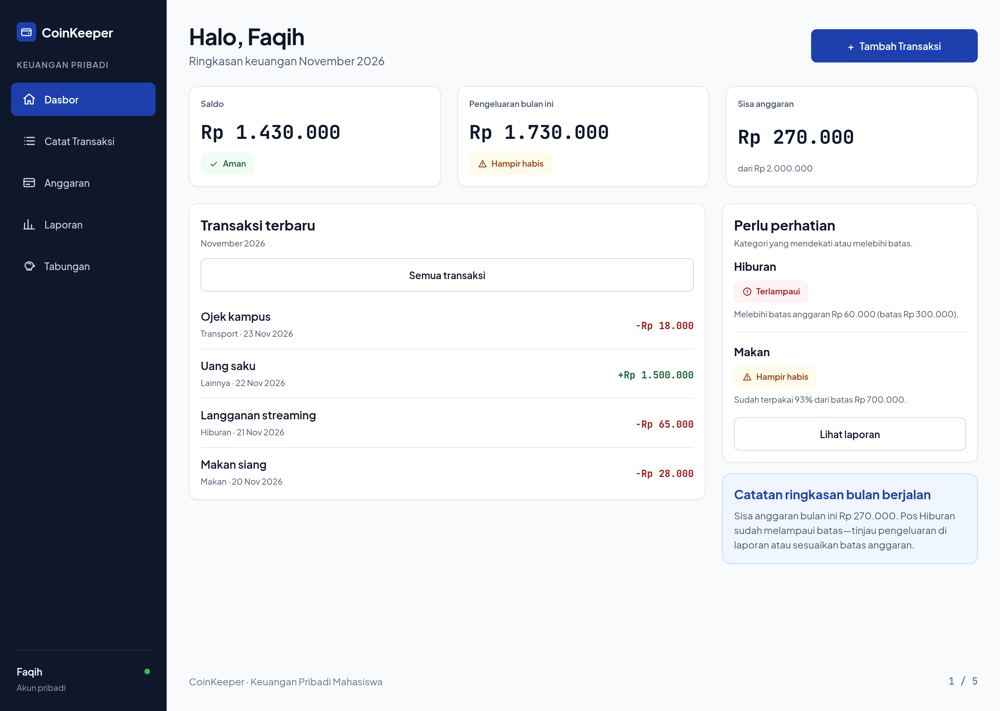
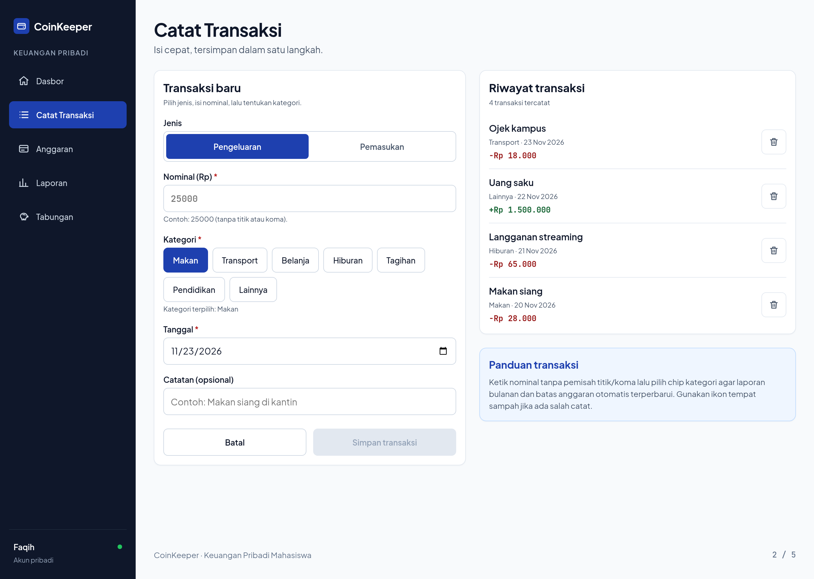
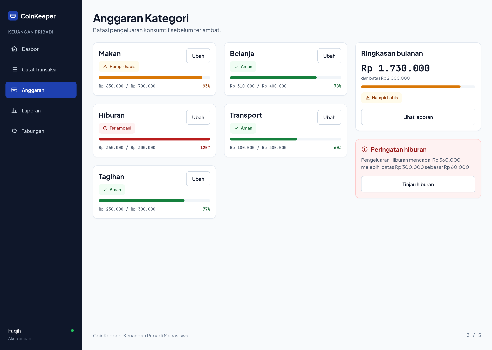
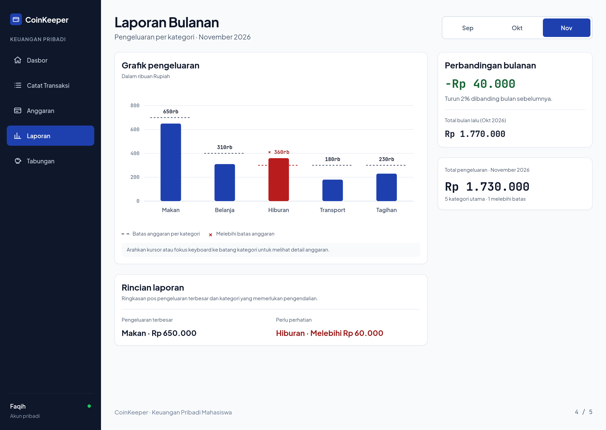
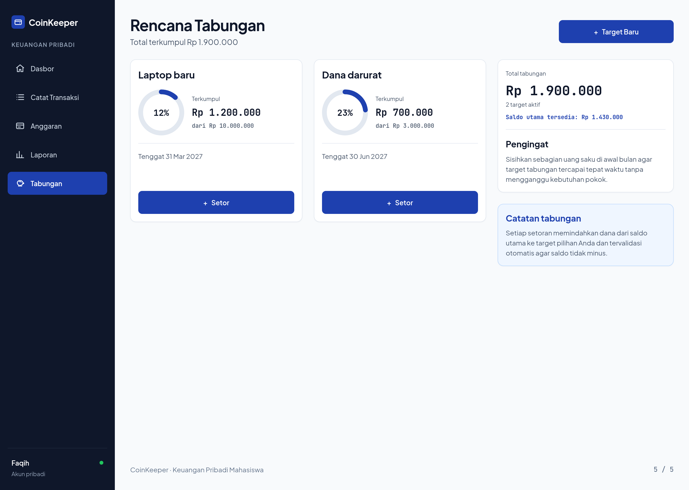
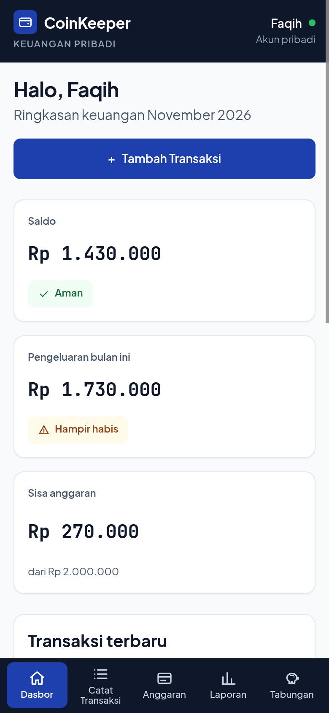

# CoinKeeper

A fast, accessible student personal finance and budgeting web application built from a high-fidelity Figma design using semantic HTML5, CSS3 design tokens, and vanilla JavaScript.




---

## About the Project

**CoinKeeper** is the final project for the *Interaksi Manusia dan Komputer* (Human-Computer Interaction) course.

- **The Problem:** Based on our initial survey of 32 university students (`referensi.pdf`), **90.6%** rely on monthly allowances from parents, **53.2%** frequently or occasionally run out of money before the end of the month, and **68.7%** rarely or never record daily expenses. Follow-up interviews in Report 1 confirmed that manual note-taking feels tedious and payment apps (QRIS / e-wallets) only display raw transfers without category budgets or early overspending warnings.
- **The Solution:** CoinKeeper reduces transaction logging friction to a quick 3-step flow (`Catat Transaksi`), enforces category spending limits with automatic warnings at 80% (*Hampir habis*) and ≥ 100% (*Terlampaui*), visualizes monthly spending against budget thresholds (`Laporan`), and tracks goal-based student savings (`Tabungan`).
- **Target Users:** Primary actor **Mahasiswa** (university students managing monthly pocket money or part-time income), modeled around persona *Rizal* (represented in the hi-fi interface as *Faqih — Akun pribadi*).

---

## Features

- **Financial Overview (`Dasbor` — HTA Task 1 & 4):**
  - Real-time KPI summary cards for *Saldo*, *Pengeluaran bulan ini*, and *Sisa anggaran*.
  - Latest 4 transactions with quick navigation to full history.
  - *Perlu perhatian* alert card surfacing categories reaching ≥ 80% or exceeding 100% of their budget.
- **Fast Transaction Logging & Recovery (`Catat Transaksi` — UC-01, KF-01, KF-02):**
  - Segmented toggle (*Pengeluaran* / *Pemasukan*), numeric input with live Rupiah formatting preview, 7 one-click category chips (*Makan, Transport, Belanja, Hiburan, Tagihan, Pendidikan, Lainnya*), date picker, and optional note.
  - 3-phase inline validation, button constraint states, confirmation modal (*Transaksi tersimpan*), destructive confirmation modal (*Hapus transaksi ini?*), and inline *Urungkan* (Undo) recovery.
- **Category Budget Limits (`Anggaran` — UC-03, KF-04, KF-05):**
  - Progress cards for 5 tracked categories (*Makan, Belanja, Hiburan, Transport, Tagihan*) with Dual-Signifier status badges (*✓ Aman*, *⚠ Hampir habis*, *! Terlampaui*).
  - Interactive limit editor modal (`Ubah`), automatic status recalculation, overbudget warning panel, and *Urungkan perubahan*.
- **Monthly Comparative Reports (`Laporan` — UC-02, KF-03):**
  - Segmented month switcher (`Sep`, `Okt`, `Nov` 2026) updating all metrics reactively.
  - Pure inline SVG vertical bar chart with per-category dashed budget threshold lines, overbudget crimson highlights, keyboard-focusable bars, month-over-month delta card, and largest/attention category breakdown.
- **Goal-Based Savings (`Tabungan` — UC-04, KF-06, KF-07):**
  - Savings goal cards (*Laptop baru*, *Dana darurat*, plus custom goals via *+ Target Baru*) with inline SVG circular progress rings.
  - Manual deposit modal (*+ Setor*) enforcing available cash balance validation (`KF-07`) and *Urungkan* recovery for both deposits and new goals.
- **Offline Client Persistence:** All mutations persist in `localStorage` (`coinkeeper_state_v1`) across all 5 pages with zero backend required.

---

## Screenshots

| Screen | Desktop View (`1440×1024`) | Highlights |
| :--- | :---: | :--- |
| **01 · Dasbor** |  | KPI cards, recent 4 transactions, and *Perlu perhatian* budget alerts |
| **02 · Catat Transaksi** |  | Segmented toggle, 7 category chips, history list, and transaction guide |
| **03 · Anggaran** |  | 5 category progress meters, monthly summary, and overbudget alert |
| **04 · Laporan** |  | Inline SVG bar chart with per-category budget thresholds and MoM delta |
| **05 · Tabungan** |  | Circular SVG progress rings, goal deadlines, and available balance summary |
| **Responsive Mobile** |  | Compact topbar, single-column reflow (`≤ 320px`), and sticky bottom navigation |

---

## HCI Principles Applied

| Course Concept | Theory / Reference | Application in CoinKeeper UI |
| :--- | :--- | :--- |
| **Interaction Styles** | *IMK 01* — Dix et al. | Combines Menu-Driven navigation (`.sidebar` / `.bottom-nav`), structured Form Fill-in (`catat-transaksi.html`), and direct selection controls. |
| **Recognition over Recall** | *IMK 02* & Nielsen H6 | All 7 categories appear simultaneously as visual chips; labels remain persistently above inputs; modals show current balance/limits inline. |
| **Visibility of System Status** | *IMK 04* & Nielsen H1 | Dual-Signifier status badges, animated 200ms progress bars, loading button states (`Menyimpan...`), toast notifications, and `aria-live="polite"`. |
| **Error Prevention & Recovery** | *IMK 02, 04, 06* & Norman | Submit button disabled until valid; deposit > balance blocked (`KF-07`); destructive delete modal with 4 easy exits (`×`, *Batal*, backdrop, `Esc`) and *Urungkan* (Undo). |
| **Information Architecture & Ergonomics** | *IMK 05* — HTA, Fitts & Hick | Shallow 1-level navigation across 5 core screens; 48px-tall full-width CTAs (Fitts's Law); small segmented choices (`n=2`, `n=3`) and chip grid (`n=7`) (Hick's Law). |
| **Visual Hierarchy & Gestalt** | *IMK 06* — Ware, Johnson | 60-30-10 color balance, Z/F/Layer-Cake scanning layouts, Common Region cards, Figure-Ground modal backdrops, and tabular monospace amounts. |
| **Accessibility (WCAG 2.2 AA)** | *IMK 06 & IMK-10* | Verified contrast ≥ 4.5:1, Dual-Signifier coding (color + icon + text), skip-link, `:focus-visible` rings, XSS-safe DOM (`textContent`), and 320px reflow. |

---

## Tech Stack

- **Markup:** Semantic **HTML5** (`<header>`, `<nav>`, `<main>`, `<section>`, `<aside>`, `<footer>`, `<dialog>`)
- **Styling:** **CSS3** with centralized `:root` Design Tokens (`css/variables.css`), BEM naming, CSS Grid (macro layout), Flexbox (micro alignment), and mobile-adaptive breakpoints
- **Scripting:** **Vanilla JavaScript (ES6+)** using classic `defer` IIFE modules (compatible directly over `file://` without CORS issues or build tools)
- **Visualization:** Pure inline **SVG** for interface icons, comparative bar charts (`pages/laporan.html`), and circular progress rings (`pages/tabungan.html`)
- **Persistence:** Browser `localStorage` + calibrated initial seed data (`js/data/seed.js`)
- **Design Source:** **Figma** (`web-hi-fi` desktop frames and `hi-fi` mobile reference)

---

## Project Structure

```text
Coin-Keeper
├── index.html                  # Screen 01 · Dasbor (main entry point)
├── pages/                      # HTML views for screens 02–05 (Catat Transaksi, Anggaran, Laporan, Tabungan)
├── css/                        # Design tokens (variables.css), base shell, reusable BEM components, and page styles
├── js/                         # App bootstrap, seed data, localStorage state manager, reusable UI modules, and page controllers
├── assets/                     # Static visual assets (brand favicon SVG)
├── docs/                       # Analysis, HTML/PDF front-end documentation, and captured screenshots
│   ├── screenshots/            # High-DPI screenshots used in documentation and this README
│   ├── 00-analysis.md          # Phase 0 research, token mapping, and HCI traceability plan
│   ├── Dokumentasi_Front-End_Coin-Keeper.html
│   └── Dokumentasi_Front-End_Coin-Keeper.pdf
└── README.md                   # Repository overview
```

---

## Getting Started

No package installation, build step, or backend server is required.

1. **Option A — Open directly in a browser:**
   - Double-click `index.html` in your file explorer to open the app immediately over `file://`.
2. **Option B — Run with a local static server:**
   - Open the folder in VS Code and launch **Live Server**, or run:
     ```bash
     python3 -m http.server 8000
     ```
   - Then visit `http://localhost:8000`.
3. **Resetting mock data:** Open Browser DevTools → Console, run `localStorage.clear()`, and reload the page to restore the initial seeded dataset.

---

## Live Demo

- **Live URL:** https://github.com/n44th44nn/Coin-Keeper

### Enabling GitHub Pages
1. Push this repository to GitHub on the `main` branch.
2. Open your repository **Settings** → **Pages**.
3. Under **Build and deployment**, set **Source** to **Deploy from a branch**.
4. Select branch **`main`** and folder **`/ (root)`**, then click **Save**.
5. Once deployed, paste the generated URL in the **Live URL** placeholder above.

---

## Documentation

- **Front-End & HCI Documentation (PDF):** [Dokumentasi_Front-End_Coin-Keeper.pdf](docs/Dokumentasi_Front-End_Coin-Keeper.pdf)
- **Documentation Print Source (HTML):** [Dokumentasi_Front-End_Coin-Keeper.html](docs/Dokumentasi_Front-End_Coin-Keeper.html)
- **Phase 0 Pre-Implementation Analysis:** [00-analysis.md](docs/00-analysis.md)
- **Project Reports (Stage 1 & Stage 2):** [Report Stage 1](docs/reports/Laporan_Proyek_Akhir_Tahap_1.pdf) and [Report Stage 2](docs/reports/Laporan_Proyek_Akhir_IMK_-_Tahap_2_(CoinKeeper).pdf)
- **Figma Prototype:** [Tugas-imk (`web-hi-fi`)](https://www.figma.com/design/FVCtagXn3FSiHgP9gGvrDz/Tugas-imk?node-id=124-2)

---

## Design

The Figma file contains three design pages:
1. **`lo-fi`:** Low-fidelity monochrome mobile wireframes mapping initial screen structure and flows.
2. **`hi-fi`:** High-fidelity mobile prototype (390×844) used as a reference for interaction flow, content copy, and small-screen bottom-bar navigation.
3. **`web-hi-fi`:** High-fidelity desktop design (45 frames at `1440×1024` covering 5 core screens plus 40 interactive states and dialogs) — **this page is the primary source of truth implemented by the website.**

- **Figma File Link:** [https://www.figma.com/design/FVCtagXn3FSiHgP9gGvrDz/Tugas-imk?node-id=124-2](https://www.figma.com/design/FVCtagXn3FSiHgP9gGvrDz/Tugas-imk?node-id=124-2)

---

## Team / Author

| Name | Student ID (NIM) | Role |
| :--- | :--- | :--- |
| Jonathan Simamora | `255150200111045` | Front-End Designer |
| Joseph Mohr Dio Sinamo | `255150200111048` | Human Computer Interaction Analysis |
| M. Reza Faris Al Faqih | `255150207111071` | Problem Elicitation |

---

## Acknowledgements

- **Course:** Interaksi Manusia dan Komputer (`CIF63108` / `CIF63109`)
- **Lecturer:** Mahardeka Tri Ananta
- **University:** Fakultas Ilmu Komputer, Universitas Brawijaya
- **Semester:** Ganjil 2026/2027

---

## License

<!-- TODO: add license (e.g., MIT License) and create a LICENSE file in the repository root -->

> **Note:** University lecture materials (`IMK 00–06` and `IMK-10`) used as theoretical references are copyright of Fakultas Ilmu Komputer, Universitas Brawijaya, and are **not** included in this repository.
